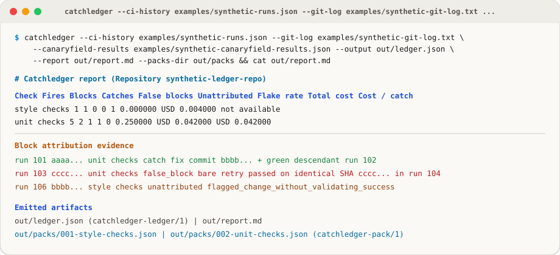
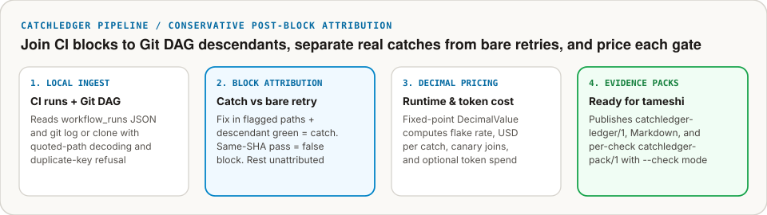
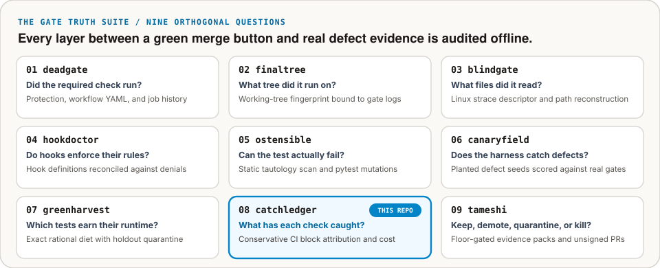

<p align="center">
  <a href="https://github.com/david-engelmann/catchledger">
    <picture>
      <source media="(prefers-color-scheme: dark)" srcset="https://raw.githubusercontent.com/david-engelmann/catchledger/main/docs/media/catchledger-lockup-dark.svg">
      
    </picture>
  </a>
</p>

<p align="center">
  <a href="https://github.com/david-engelmann/catchledger/blob/main/docs/GUIDE.md"><b>Operator Guide</b></a> |
  <a href="https://david-engelmann.github.io/catchledger/">Published Docs</a> |
  <a href="https://github.com/david-engelmann/catchledger/tree/main/examples">Examples</a> |
  <a href="https://github.com/david-engelmann/catchledger/blob/main/docs/ARCHITECTURE.md">Architecture</a> |
  <a href="https://github.com/david-engelmann/catchledger/blob/main/docs/FORMATS.md">Wire Formats</a> |
  <a href="https://github.com/david-engelmann/catchledger/blob/main/docs/COMPARISON.md">Comparison</a> |
  <a href="https://github.com/david-engelmann/catchledger/blob/main/docs/FAQ.md">FAQ</a> |
  <a href="https://github.com/david-engelmann/catchledger/releases">Releases</a>
</p>

<p align="center">
  <a href="https://github.com/david-engelmann/catchledger/actions/workflows/ci.yml"></a>
  <a href="https://david-engelmann.github.io/catchledger/"></a>
  <a href="https://github.com/david-engelmann/catchledger/blob/main/Cargo.toml"></a>
  <a href="https://github.com/david-engelmann/catchledger/blob/main/LICENSE"></a>
</p>

# catchledger

It records fires, blocks, true catches, false blocks, flake rate, runtime, and cost per catch for each gate, joined from CI logs to what happened next.

<p align="center">
  <picture>
    <source media="(prefers-color-scheme: dark)" srcset="https://raw.githubusercontent.com/david-engelmann/catchledger/main/docs/media/terminal-showcase-dark.svg">
    
  </picture>
</p>

## What this is

Dashboards total runs and failures, and no tool anywhere computes which of a team's checks has caught anything lately. Catchledger ingests CI history and git history for one repo and builds one page per check, attributing true catches conservatively from what happened after each block. A block followed by a fix in the flagged code counts as a catch, and a block followed by a bare retry counts against the check. It is the ledger the other gate instruments write their evidence into and the verdict tools read from. The boundary with its sibling is one sentence. Catchledger prices checks, secondbill prices work.

<p align="center">
  <picture>
    <source media="(prefers-color-scheme: dark)" srcset="https://raw.githubusercontent.com/david-engelmann/catchledger/main/docs/media/how-it-works-dark.svg">
    
  </picture>
</p>

## Install

Install from source with Cargo (Rust `1.70` or newer on Linux and macOS) or install verified prebuilt archives via `install.sh` or `cargo-binstall` once release archives are attached (`v0.37.0` and `v0.38.0` onward).

```sh
cargo install --git https://github.com/david-engelmann/catchledger --locked
```

```sh
curl -fsSL https://raw.githubusercontent.com/david-engelmann/catchledger/main/install.sh | sh
export PATH="$HOME/.local/bin:$PATH"
cargo binstall --git https://github.com/david-engelmann/catchledger catchledger
```

## Quickstart

Run `catchledger` over the synthetic CI runs, Git log, and `canaryfield` results in `examples/` to emit `ledger.json` (`catchledger-ledger/1`), `report.md`, and per-check `catchledger-pack/1` files ready for `tameshi`.

```sh
git clone https://github.com/david-engelmann/catchledger.git
cd catchledger
mkdir -p /tmp/cl-demo
catchledger \
  --ci-history examples/synthetic-runs.json \
  --git-log examples/synthetic-git-log.txt \
  --canaryfield-results examples/synthetic-canaryfield-results.json \
  --output /tmp/cl-demo/ledger.json \
  --report /tmp/cl-demo/report.md \
  --packs-dir /tmp/cl-demo/packs
cat /tmp/cl-demo/report.md
```

```markdown
# Catchledger report

Repository synthetic-ledger-repo

## Totals

| Measure | Value |
| --- | ---: |
| Fires | 6 |
| Blocks | 3 |
| Catches | 1 |
| False blocks | 1 |
| Unattributed blocks | 1 |
| False block rate | 0.333333 |
| Runtime seconds | 345 |
| Runtime minutes | 5.750000 |
| Total cost | USD 0.046000 |
```

In `unit checks`, run `101` blocked commit `aaaa...`, commit `bbbb...` modified `src/math.py`, and run `102` passed on `bbbb...` (`catch`, `Cost per catch USD 0.042000`), whereas run `103` failed on `cccc...` and run `104` passed on a bare retry of the identical commit `cccc...` (`false_block`, `Flake rate 0.250000`).

## Exporting Inputs from GitHub

Catchledger makes zero network calls. Export paginated GitHub Actions workflow runs and local Git history inside a subshell, passing `--repo-label "$REPO"` explicitly alongside `--no-show-signature`.

```sh
(
  set -eu
  REPO="owner/repo"
  gh api --paginate "repos/$REPO/actions/runs?per_page=100" \
    | jq -s --arg repo "$REPO" '{repo: $repo, workflow_runs: map(.workflow_runs[])}' > runs.json
  git --no-pager log --reverse --topo-order --no-show-signature -M \
    --pretty='format:commit %H%nparents %P%ndate %cI%nsubject %s' --name-status > git-log.txt
  catchledger \
    --ci-history runs.json \
    --git-log git-log.txt \
    --repo-label "$REPO" \
    --output ledger.json \
    --report report.md \
    --packs-dir packs
)
```

## Verification and Footprint

Run the full local gate on Linux (and package/lint checks on Linux or macOS).

```sh
cargo test --locked
cargo fmt --check
cargo clippy --offline --all-targets
cargo package --locked
```

| Property | Value |
| --- | --- |
| External crate dependencies | `0` (`std` only) |
| Minimum Supported Rust Version | `1.70` |
| Release binary size (`aarch64-apple-darwin`) | `918.9 KiB` |
| Cost and rate arithmetic | Exact fixed-point `DecimalValue` |
| Network calls | `0` |

## The Gate Truth Suite

<p align="center">
  <picture>
    <source media="(prefers-color-scheme: dark)" srcset="https://raw.githubusercontent.com/david-engelmann/catchledger/main/docs/media/gate-truth-arc-dark.svg">
    
  </picture>
</p>

| Tool | Question answered | Primary evidence |
| --- | --- | --- |
| [deadgate](https://github.com/david-engelmann/deadgate) | Did the required check actually run? | Branch protection, workflow YAML, and job history |
| [finaltree](https://github.com/david-engelmann/finaltree) | What exact tree did the gate run on? | Working-tree SHA-256 fingerprint bound to stamped logs |
| [blindgate](https://github.com/david-engelmann/blindgate) | What files did the gate actually read? | Linux `strace` descriptor and path reconstruction |
| [hookdoctor](https://github.com/david-engelmann/hookdoctor) | Do hooks enforce their declared rules? | Hook definitions reconciled against execution denials |
| [ostensible](https://github.com/david-engelmann/ostensible) | Can the test actually fail? | Static tautology scan and `pytest` mutations |
| [canaryfield](https://github.com/david-engelmann/canaryfield) | Does the harness catch planted defects? | Seeded defect classes scored across real gates |
| [greenharvest](https://github.com/david-engelmann/greenharvest) | Which tests earn their CI runtime? | Exact rational value ranking and reversible quarantine |
| [catchledger](https://github.com/david-engelmann/catchledger) | What has each check caught, and at what cost? | Conservative post-block Git DAG attribution and USD cost |
| [tameshi](https://github.com/david-engelmann/tameshi) | Keep, demote, quarantine, or kill this check? | 30-defect and 14-day floor-gated unsigned ruling PRs |

## Documentation

| If you want to... | Read |
| --- | --- |
| Browse the searchable handbook with diagrams | [Published documentation](https://david-engelmann.github.io/catchledger/) |
| Export paginated GitHub runs, join `flighttape` tokens, and run `--check-*` | [Operator Guide](https://github.com/david-engelmann/catchledger/blob/main/docs/GUIDE.md) |
| Understand Git DAG block attribution and `DecimalValue` pricing | [Architecture](https://github.com/david-engelmann/catchledger/blob/main/docs/ARCHITECTURE.md) |
| Integrate `catchledger-ledger/1` and `catchledger-pack/1` schemas | [Wire Formats](https://github.com/david-engelmann/catchledger/blob/main/docs/FORMATS.md) |
| Compare `catchledger` against CI vendor dashboards and `secondbill` | [Comparison](https://github.com/david-engelmann/catchledger/blob/main/docs/COMPARISON.md) and [FAQ](https://github.com/david-engelmann/catchledger/blob/main/docs/FAQ.md) |
| Review threat boundaries, vulnerability reporting, and contribution gates | [Security Policy](https://github.com/david-engelmann/catchledger/blob/main/SECURITY.md) and [Contributing](https://github.com/david-engelmann/catchledger/blob/main/CONTRIBUTING.md) |

## Status

- Slice 2 is built and proven on synthetic targets only
- Slice 2 ingests a local workflow run export and a local Git history export or clone and builds the per check scorecard with fires and blocks and true catches and false blocks and flake rate and runtime and cost per catch
- Slice 2 attributes a catch only when a later change in the flagged code is followed by a successful run on a descendant commit and counts a block followed by a bare retry against the check and leaves every other block unattributed
- Slice 2 publishes the evidence pack format catchledger-pack/1 with one validated pack for each check and writes a deterministic JSON ledger and markdown report through the command line
- Slice 2 is the Round 1 work increment, and Round 1 closed after audit and two-axis review and red team and owner approval, with the review fixes landed on the same branch
- Round 2 adds the duplicate JSON key refusal, so every JSON document the tool reads refuses a document that carries the same key twice in one object, naming the document and the repeated key
- Round 2 also lands the first Rust port slice, a library crate with a thin binary covering the ledger core and the JSON reader and the canaryfield substrate, proven by 303 recorded conformance cases generated from the Python implementation, which stays in place as the spec
- Round 3 lands the second Rust port slice, carrying workflow run ingestion and Git log parsing and clone reading and the repository label reading and the digest helpers into the crate, proven by 161 new recorded conformance cases beside the standing 303, with the Python implementation standing in place as the spec
- Round 4 lands the closing slice of the port, carrying the command line whole into the binary and retiring the Python package and suite, proven by a recorded black box battery of 40 invocations beside the standing recordings, with the clone case's git history digest proven by recomputation against the running git as the earlier slices established, so the tree stands Rust whole on both surfaces
- Round 6 lands slice 5, the quoted path decoding, retiring the ground's stated limit that a path git renders in its quoted form is recorded in that form, so changed paths and flagged paths stand in the spelling the tree carries in the commit records and the catch records and the evidence packs
- Closed rounds stand at 38 of 100
- Seeded in October 2026. Part of the impatient programming portfolio, in the Gate Truth arc

## Licence

MIT. See LICENSE.
