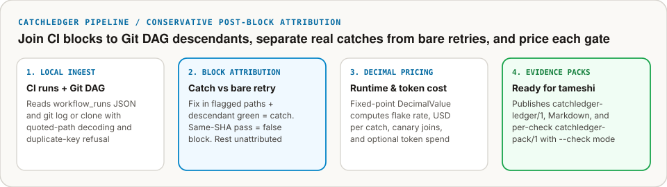

# Catchledger Architecture

Catchledger prices checks by joining local CI workflow-run history and Git commit ancestry into a deterministic per-check scorecard and publishing validated `catchledger-pack/1` evidence packs for downstream ruling tools. Implemented as a zero-dependency pure-Rust library (`src/lib.rs`) and CLI (`src/main.rs`), Catchledger makes zero network calls in production code or tests.

  <picture>
    <source media="(prefers-color-scheme: dark)" srcset="https://raw.githubusercontent.com/david-engelmann/catchledger/main/docs/media/how-it-works-dark.svg">
    
  </picture>

## Pipeline Stages

### 1. Strict JSON and Git History Readers (`src/jsonvalue.rs`, `src/reader.rs`, `src/ingest.rs`)

JSON inputs (`--ci-history`, `--canaryfield-results`, and `--token-usage`) are parsed by Catchledger's pure-Rust JSON reader, refusing duplicate object keys at any depth and bounding nesting at `4000`. Git commit ancestry arrives either from a local `--git-log` export or via `--git-repo` (reading commit stanzas locally from `git log --reverse --topo-order -M` under explicit timestamp bounds). Paths that Git renders in C-quoted octal or escape notation are decoded back to raw tree paths so non-ASCII and special filenames match across commit records and evidence packs.

### 2. Conservative Post-Block DAG Attribution (`src/ledger.rs`)

For each check's blocking runs (`conclusion == "failure"`), Catchledger records the blocked commit's changed paths from Git history as `flagged_paths` and inspects subsequent workflow runs and the Git commit DAG

- **Bare retry (`false_block`)** If a later run of the same check succeeds on the *exact same* `head_sha`, the block is attributed as a `false_block` against the check, and commits where completed runs of the same check disagree contribute to `flaky_commits` and `flake_rate`.
- **Validated fix (`catch`)** If no bare retry succeeded on that SHA, and a descendant commit modifies at least one path in `flagged_paths` followed by a green run of the same check on a descendant commit, the block counts as a true `catch` carrying its `fix_commits` and `validating_run_id`.
- **Conservative remainder (`unattributed`)** Every other block stays `unattributed` with an explicit diagnostic `reason` (such as `flagged_change_without_validating_success`) rather than overclaiming catches or flakes.

### 3. Fixed-Point `DecimalValue` Cost Accounting (`src/decimal.rs`, `src/token.rs`)

Runtime durations, per-minute compute rates (`--cost-per-minute`, default `"0.008"` USD/min), `total_cost_usd`, `cost_per_catch_usd`, and optional LLM input/output token figures (`catchledger-token-cost/1`) are evaluated with Catchledger's exact fixed-point decimal engine (`DecimalValue`) matching Python `decimal.Decimal` rounding rules without binary float drift.

### 4. Validated Pack Emission and Read-Only Check Modes (`src/report.rs`, `src/render.rs`)

In write mode, Catchledger emits `catchledger-ledger/1`, the Markdown scorecard, and numbered `catchledger-pack/1` files (`001-<slug>.json`, `002-<slug>.json`), re-validating its own emitted packs before returning. In read-only check mode, `--check-ledger`, `--check-packs`, and `--check-token-cost` compare freshly computed structures against reference JSON documents without writing files, and `--check-report` verifies exact Markdown byte identity.

## Packaging and Runtime Footprint

- **External Rust dependencies** `0` (`std` only)
- **Minimum Supported Rust Version** `1.70`
- **Network calls** `0`
- **Release binary size (`aarch64-apple-darwin`)** `918.9 KiB`
- **Parser nesting bound** `4000`
