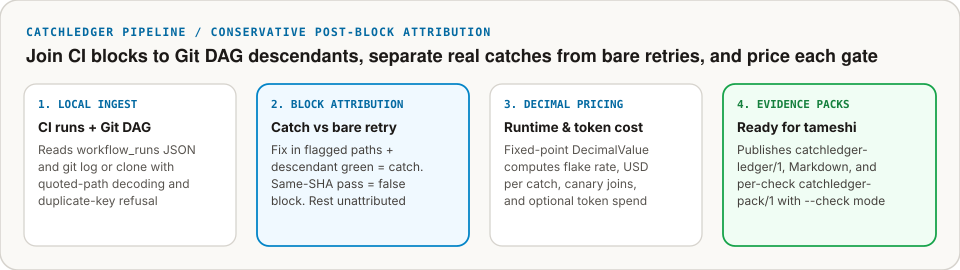
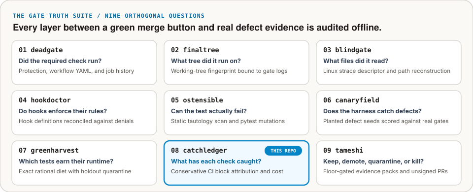

# catchledger Documentation

Catchledger prices checks by joining offline CI workflow-run history to Git commit ancestry, conservatively attributing true catches versus bare-retry false blocks, computing flake rates and cost per catch, and publishing per-check evidence packs for downstream Gate Truth ruling tools.

  <picture>
    <source media="(prefers-color-scheme: dark)" srcset="https://raw.githubusercontent.com/david-engelmann/catchledger/main/docs/media/how-it-works-dark.svg">
    
  </picture>

## Handbook Contents

- [Operator Guide](GUIDE.md) Step-by-step installation, all seventeen CLI flags, paginated `gh api` and `git log` export scripts, `flighttape` token-usage conversion, and GitHub Actions workflows.
- [Architecture](ARCHITECTURE.md) Post-block Git DAG attribution, quoted-path decoding, fixed-point `DecimalValue` accounting, parser bounds, and Gate Truth suite boundaries.
- [Wire Formats](FORMATS.md) Deterministic JSON and Markdown schemas across `catchledger-ledger/1`, `catchledger-pack/1`, `catchledger-token-usage/1`, and `catchledger-token-cost/1`.
- [Comparison](COMPARISON.md) Technical comparison against CI vendor dashboards, flaky-test trackers, agent cost trackers (`secondbill`), and sibling Gate Truth tools.
- [FAQ](FAQ.md) Direct answers to common attribution, repository-label, rerun attempt, and check-mode questions.
- [Changelog](../CHANGELOG.md) Release milestone summaries.
- [Security Policy](../SECURITY.md) Execution model and private vulnerability reporting.
- [Contributing](../CONTRIBUTING.md) Contract-first development rules and exact-final-head local gates.

  <picture>
    <source media="(prefers-color-scheme: dark)" srcset="https://raw.githubusercontent.com/david-engelmann/catchledger/main/docs/media/gate-truth-arc-dark.svg">
    
  </picture>

